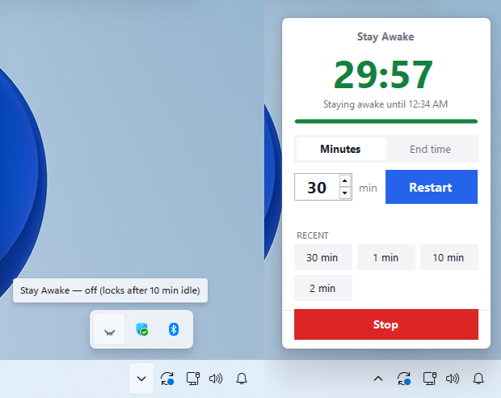

# Stay Awake for Windows

<p align="center">
  
</p>

A security tool for school and work PCs. It locks the PC after an admin-set number of minutes without keyboard or mouse input, even when a browser, media player, or document-camera program is holding the screen awake. A teacher can start a **grace period** (up to an admin-set maximum) to keep the PC unlocked while presenting. Nothing starts on its own.

It's the Windows counterpart of the [Stay Awake Chrome extension](https://github.com/myoung8223/stayawake), with the same minimalist window. It installs from one MSI, so you can deploy it with SCCM (ConfigMgr), Intune, or Group Policy.

## Using it (teachers)

- **Open it:** click the eye icon in the system tray, or press the hotkey (Ctrl+Alt+S by default). The icon may be under the ^ overflow arrow.
- **Start by minutes:** choose **Minutes**, type a duration (60 is pre-filled), and press **Start** or Enter.
- **Start by end time:** choose **End time** and pick a clock time. The window shows the resulting run ("Runs 35 min, until 1:00 PM") before you start.
- **Recent:** each mode keeps one-click buttons for your last 9 durations and last 9 end times. An end time that's currently out of range is grayed out.
- **Change or extend:** while it's running, enter a new duration or end time (or click a recent button) and press **Restart**. The countdown starts over; it doesn't add to the time left.
- **Stop:** the red **Stop** button.
- **Status:** the tray icon is a gray closed eye when off, and a green badge with the minutes left during a grace period.

Nothing ever starts on its own. The window can't be closed or the program ended by users; Escape or clicking elsewhere just hides the window.

## How it works

Two programs, installed together by one MSI:

| Program | Runs as | Job |
|---|---|---|
| `StayAwakeService.exe` | SYSTEM (Windows service, automatic) | Owns the policy and every session's grace period. Decides when to lock. Starts the tray program in each signed-in session. |
| `StayAwake.exe` | The signed-in user | Tray icon, hotkey, and window. Reports idle time to the service every second. Locks the PC when told to. |

**Why apps can't block the lock.** Browsers and media players keep the screen on with power requests (the ones `powercfg /requests` lists). Those pause Windows' own idle timer, but they don't touch the input clock Stay Awake reads, and Stay Awake calls `LockWorkStation()` itself.

**Why users can't kill it.**

- Standard users can't stop or change a SYSTEM service.
- The service starts the tray program with permissions that deny "End task" and `taskkill` to standard users (they get *Access denied*).
- If the tray program disappears or stops reporting anyway, the service restarts it, and outside a grace period it **locks the session after 30 seconds** (fail closed).
- If a lock doesn't happen, the service escalates: after 4 seconds it runs `StayAwake.exe /lock` in the session, and after 10 seconds it disconnects the session, which drops it to the sign-in screen.
- Only the installed `StayAwake.exe` in Program Files may talk to the service. A copy or look-alike program elsewhere is rejected.
- Grace periods live in the service, so restarting the tray program can't extend or cancel one.

**Grace periods.**

- The idle limit sits on the tail end of a grace period. When a grace period ends, the normal idle rule applies at once, counting from the last real input, with no warning. With a 30-minute grace period and a 10-minute idle lock:
  - No input at all: it locks at 30 minutes, not 40.
  - Input with 5 minutes left: it locks 5 minutes after the grace period ends.
- Locking the PC (Win+L or the idle lock), signing out, or rebooting ends any grace period.

## Requirements

- **Target PCs:** 64-bit Windows 10 (1903 or later) or Windows 11. They need nothing extra: .NET Framework 4.8 is built into those versions.
- **Build PC:** Windows with the [.NET SDK](https://dotnet.microsoft.com/download). No Visual Studio, no WiX, no other tools.

## Building

1. Open a Command Prompt in this folder.
2. Run:
   ```
   build.cmd 1.0.1
   ```
3. The installer is written to `out\StayAwake-1.0.1.msi`. The loose programs are in `out\bin`.

The first build downloads the .NET Framework 4.8 reference assemblies from NuGet, so it needs internet once.

Use a higher version number for every build you deploy (`1.0.2`, `1.0.3`, …). A new MSI replaces any older or same-version install automatically. It refuses to install over a newer one.

## Installing

For a one-page command reference, see [INSTALL.md](INSTALL.md).

Run as an administrator. Every setting has a default, so all properties are optional.

```
msiexec /i StayAwake-1.0.1.msi /qn
msiexec /i StayAwake-1.0.1.msi /qn IDLEMINUTES=10 MAXGRACE=60 HOTKEY="Ctrl+Alt+S" HISTORYSCOPE=User
msiexec /i StayAwake-1.0.1.msi /qn ALLOWEDGROUP="SCHOOL\Staff" /l*v C:\Windows\Temp\StayAwake-install.log
```

Double-clicking the MSI also works; it asks for admin rights.

### Admin settings (MSI properties)

| Property | Default | Meaning |
|---|---|---|
| `IDLEMINUTES` | `10` | Minutes without keyboard or mouse input before the PC locks (1–1440). |
| `MAXGRACE` | `60` | Longest grace period a user may start, in minutes (1–1440). The window pre-fills 60, or the max if it's lower. |
| `HOTKEY` | `Ctrl+Alt+S` | Opens the window. Modifiers `Ctrl`, `Alt`, `Shift`, `Win` plus one key, for example `Win+Alt+K` or `Ctrl+Shift+F9`. `None` disables it. Windows reserves most Win+letter combinations; if a hotkey can't be registered, the About box says so and the tray icon still works. |
| `HISTORYSCOPE` | `User` | `User`: each person keeps their own recent durations and end times. `Machine`: everyone on the PC shares them. Machine-wide lists start fresh after an upgrade; per-user lists are kept. |
| `ALLOWEDGROUP` | *(empty)* | Who may start grace periods. Empty means everyone. Otherwise one or more groups, users, or SIDs separated by semicolons, for example `SCHOOL\Staff` or `Teachers` (a local group) or `Teachers;SCHOOL\Admins-IT`. Everyone else sees "Not available for this account", and the idle lock still applies to them. Group membership is read at sign-in, so a newly added member must sign out and back in. |
| `IGNOREINJECTED` | `0` | `1`: keyboard and mouse input generated by software (mouse jigglers, "keep awake" utilities, scripts using SendInput) doesn't count as activity. Touch and pen still count. Test it first: remote-control tools and the on-screen keyboard also generate software input. |
| `ARPSYSTEMCOMPONENT` | *(unset)* | `1` hides Stay Awake from Apps & Features. |
| `ARPNOREMOVE` | *(unset)* | `1` removes the Uninstall button from Apps & Features. |

The MSI writes these to `HKLM\SOFTWARE\Policies\StayAwake` (`IdleLockMinutes`, `MaxGraceMinutes`, `Hotkey`, `HistoryScope`, `AllowedGroup`, `IgnoreInjectedInput`). You can change them later there or with Group Policy Preferences, without reinstalling:

- The service rereads them within 10 seconds.
- The hotkey and the injected-input setting take effect at the user's next sign-in.

Standard users can't uninstall a per-machine MSI; Windows asks for admin rights.

## Deploying with SCCM (ConfigMgr)

1. Create an **Application** from the MSI. ConfigMgr reads the product code for detection automatically.
2. Set the installation program, for example:
   ```
   msiexec /i "StayAwake-1.0.1.msi" /qn IDLEMINUTES=10 MAXGRACE=60 ALLOWEDGROUP="SCHOOL\Staff"
   ```
   Use different deployment types or applications for collections that need different settings.
3. Set the uninstall program:
   ```
   msiexec /x {product code} /qn
   ```
4. Set installation behavior to **Install for system**, whether or not a user is logged on.
5. For a new build, create a new application and set it to **supersede** the old one. Each build has a new product code, but they share one upgrade code, so the new MSI removes the old one by itself.

## Uninstalling

Run as an administrator:

```
msiexec /x StayAwake-1.0.1.msi /qn
```

You can also use the product code, or Apps & Features.

Uninstalling removes:

- The service and the programs
- The policy values
- Machine-wide history
- The log folder

Per-user history in each profile (`HKCU\Software\StayAwake`) is left behind. It's a few small registry values.

## Logs

The service log is `C:\ProgramData\StayAwake\service.log`. Standard users can read it but not change it. It records:

- Policy at startup
- Agent launches
- Grace periods started or stopped, with the user name
- Every lock and its reason
- Rejected pipe clients
- Group-name lookups that failed

## Testing checklist (workgroup PC)

1. **Install with short timers.** Run `build.cmd`, then install with `IDLEMINUTES=2 MAXGRACE=5`. Confirm that **Stay Awake** is running in `services.msc` and that a gray closed-eye icon appears in the tray. The tray icon may sit under the ^ overflow arrow; you can drag it onto the taskbar.
2. **Idle lock.** Leave the PC alone for 2 minutes. It should lock.
3. **Override.** Play a YouTube video fullscreen in Edge or Chrome. Run `powercfg /requests` in an admin prompt to confirm the browser holds a DISPLAY request. Leave the PC alone; it should still lock at 2 minutes.
4. **Grace period.** Open the window (tray icon or Ctrl+Alt+S) and start 3 minutes. The icon turns green with the minutes left. Leave the PC alone. It should stay unlocked for 3 minutes, then lock immediately when the grace period ends.
5. **End time.** Switch to End time, pick a time 2–4 minutes away, and start. Check that recent buttons appear, that an end time out of range is grayed out, and that the mode is remembered.
6. **Kill attempt.** As a standard user, try Task Manager > End task on Stay Awake. You should get *Access denied*. The window ignores close requests.
7. **Fail closed.** As an admin, run `taskkill /f /im StayAwake.exe` without a grace period running. The service restarts the tray program within about 10 seconds. If it can't, the session locks within 30 seconds.
8. **Allowed group.** Create a local group `Teachers`, then reinstall with `ALLOWEDGROUP=Teachers`. A user outside the group sees "Not available for this account", and the idle lock still applies.
9. **Uninstall.** Run `msiexec /x`. The tray icon disappears, and the service, `C:\Program Files\StayAwake`, and `C:\ProgramData\StayAwake` are removed.

## Limits

- **Administrators can turn it off.** They can stop the service or uninstall it. That's intended.
- **Software input counts as activity by default.** A mouse jiggler or script that fakes input keeps the PC "active". Set `IGNOREINJECTED=1` to close that gap.
- **A USB hardware jiggler looks like a real mouse.** No software can tell the difference.
- **A determined user with developer tools could, in principle, tamper with the tray program's threads in their own session.** The service's fail-closed checks catch a stopped or silent tray program, but not one that keeps reporting false idle times.

## Source layout

```
build.cmd                 build everything + MSI
src/Shared/               policy and agent/service protocol (compiled into both programs)
src/Service/              Windows service: enforcement, sessions, launching, pipe server
src/Agent/                tray program: window, tray icon, hotkey, idle monitor
src/MsiBuilder/           writes the MSI using Windows' built-in msi.dll and makecab.exe
```

## Dependencies and licensing

Nothing third-party is shipped. The installed programs use only:

- The .NET Framework 4.8 class library (Windows Forms, services, named pipes), which is part of Windows.
- Windows APIs from the system DLLs: `user32`, `kernel32`, `advapi32`, `wtsapi32`, `userenv`, and `dwmapi`.

Build tools, used on the build PC only:

- **The .NET SDK** compiles the code.
- **The `Microsoft.NETFramework.ReferenceAssemblies` NuGet package** supplies the .NET Framework 4.8 reference files. It's downloaded automatically and MIT-licensed.
- **`makecab.exe` and `msi.dll`**, both built into Windows, produce the MSI. No WiX, so no WiX licensing or maintenance fee applies.

None of these build tools end up in the output.

The MSI and programs are unsigned. If Microsoft Defender, AppLocker, or App Control blocks them, allow `StayAwake.exe` and `StayAwakeService.exe` by SHA256 hash, or allow the `C:\Program Files\StayAwake` path. Hashes change with every build. Code-signing with your own certificate avoids re-entering them.

## Credits

Developed by Mike Young ([@myoung8223](https://github.com/myoung8223)) using Anthropic Claude Opus 5.5.

## License

[MIT](LICENSE) © 2026 Mike Young
